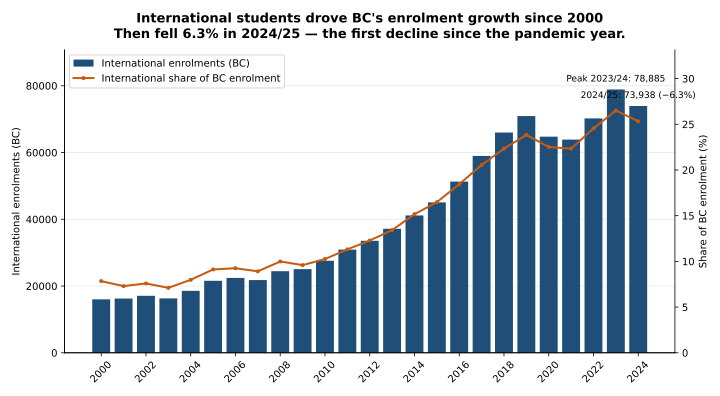
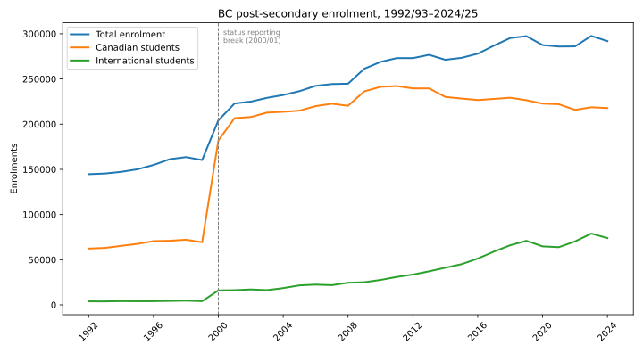
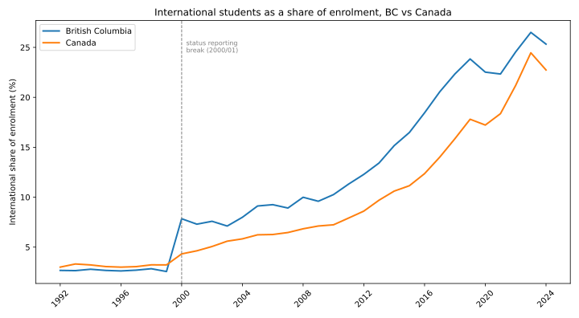

# BC Post-Secondary Enrolment Trends — with an International Student Highlight

**Question:** How has post-secondary enrolment in British Columbia
trended, and what do international student enrolment trends in BC and Canada
show within that picture?

**Short answer:** Since 2000, BC's post-secondary system has grown mainly
because of international students. International enrolment in BC rose from
about 16,000 to nearly 74,000, and now makes up one in four enrolments — a
higher share than in Canada as a whole. That growth peaked in 2023/24 and
dipped in 2024/25, the first decline since the pandemic year.

**By:** Emmanuel Kweku Benyi — MBA (data analytics), University Canada West;
Admissions Advisor, Discovery Community College, Surrey, BC.

## Executive summary



**Takeaway:** International students drove two-thirds of BC's enrolment
growth since 2000 — then fell 6.3% in 2024/25, the first decline since the
pandemic year.

## What the data shows

All figures below come from Statistics Canada table 37-10-0018-01 (see
Sources). Comparisons use 2000/01 onward, because that is when student-status
reporting becomes consistent (see Limitations).

### British Columbia

- **Total enrolment grew 43%**, from 204,180 in 2000/01 to 291,930 in 2024/25.
- **International students drove two-thirds of that growth.** International
  enrolment rose from 16,011 to 73,938 — more than four times higher — while
  domestic (Canadian student) enrolment grew only about 20%, from 181,947 to
  217,839. Domestic enrolment has actually fallen since 2010/11, when it was
  241,305.
- **One in four BC enrolments is now international.** The international share
  rose from 7.8% in 2000/01 to a record 26.5% in 2023/24 (78,885 students),
  then eased to 25.3% in 2024/25 (73,938 students) — a 6.3% drop from the peak.
- **Total BC enrolment also dipped in 2024/25**, down 1.9% from its 2023/24
  peak of 297,645.

### Canada, for comparison

- **Total enrolment grew 63%**, from 1,440,168 in 2000/01 to 2,345,775 in
  2024/25. International enrolment rose from 62,223 to 533,382 — more than
  eight times higher — accounting for about half of all growth.
- **The international share reached a record 24.5% in 2023/24** (572,967
  students), then fell to 22.7% in 2024/25 (533,382 students), a 6.9% drop.
- **BC's international share now runs above Canada's** (25.3% vs 22.7% in
  2024/25), and it has done so for most of the past decade.

### The two dips

International enrolment has fallen twice in this series: in the pandemic
year 2020/21 (BC down 8.7%) and again in 2024/25 (BC down 6.3%, Canada down
6.9%). One down year is not yet a trend, and this data alone cannot say
whether the 2024/25 dip reflects policy changes, demand, or something else —
that would need a different dataset.





## Data sources

- **Statistics Canada, table 37-10-0018-01** — "Postsecondary enrolments, by
  registration status, institution type, status of student in Canada and
  gender."
  - Table page: https://www150.statcan.gc.ca/t1/tbl1/en/tv.action?pid=3710001801
  - Full CSV download used here:
    https://www150.statcan.gc.ca/n1/tbl/csv/37100018-eng.zip
- The filtered dataset in this repo (`data/bc_canada_enrolment.csv`) keeps
  only: total institution type, total registration status, total field of
  study, total gender, enrolment counts, for British Columbia and Canada,
  split by Canadian / international / total student status, academic years
  1992/93–2024/25.

No personal data is used anywhere in this project.

## Data dictionary — `data/bc_canada_enrolment.csv`

The file is the pivoted, filtered dataset: one row per academic year
(1992/93–2024/25), with a two-level column header (geography, then student
status). Cell values are **numbers of enrolments** — students enrolled, not
applications or admissions.

| Column | Meaning |
|--------|---------|
| `REF_DATE` | Academic year, e.g. `2024/2025` (the row index). |
| `GEO` — `British Columbia` / `Canada` | Geography the enrolments are counted for. |
| `Status of student in Canada` — `Canadian students` | Enrolments of Canadian students. |
| `Status of student in Canada` — `International students` | Enrolments of international students. |
| `Status of student in Canada` — `Total, status of student in Canada` | All enrolments (Canadian + international + the small unclassified remainder in early years). |

Scope note: the file keeps totals only — total institution type, total
registration status, total field of study, and total gender — so it has no
breakdown by university vs college, program, or level of study.

## How to re-run the analysis

```bash
pip install -r requirements.txt
python analysis.py
```

On first run the script downloads the Statistics Canada table (about 67 MB),
filters it, prints the headline findings, and writes the filtered dataset to
`data/bc_canada_enrolment.csv` and the charts to `charts/` (PNG and SVG).
The downloaded ZIP lands in the repository root and is gitignored — it is
never committed. Tests need no download (they use the filtered CSV):

```bash
pytest
```

## Limitations — read before quoting these numbers

- **Enrolments, not applications.** This table counts students enrolled. It
  says nothing about how many people applied, were admitted, or were turned
  away, so it cannot answer questions about admission rates or demand.
- **A reporting break in 2000/01.** Before that year, many enrolments had no
  recorded student status (in BC, about 87,000 unclassified enrolments in
  1999/2000, falling to about 6,000 in 2000/01). That is why the charts show a
  sharp jump around 2000 and why this write-up compares years from 2000/01
  onward. Figures before the break are shown for completeness, not for
  trend claims.
- **Totals include all institution types and fields of study.** The analysis
  does not break results down by university vs college, program, or level
  of study.
- **Latest year is 2024/25.** The 2024/25 dip is a single year of data; it
  does not by itself establish a new trend.
- **No causes are claimed.** The data shows what happened, not why. Policy,
  immigration, institutional, and economic factors are outside this dataset.
